# Festro — Digital Growth Portal

**Digital Growth. Built Smarter.**

Festro is a client portal for a digital growth company. Clients sign in to one place to see revenue and leads, work with an AI growth assistant, track SEO and visibility in AI search, follow campaigns and delivery, and get client-ready reports.

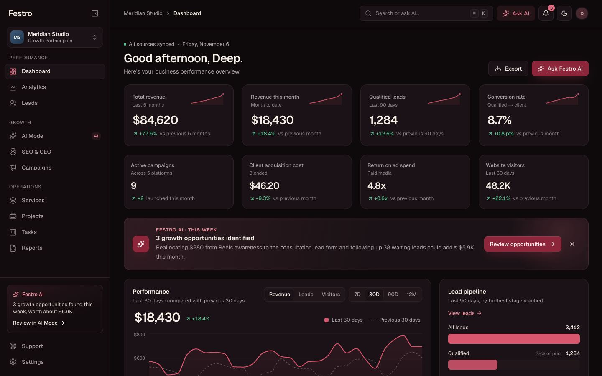

---

## Screenshots

| | |
|---|---|
| 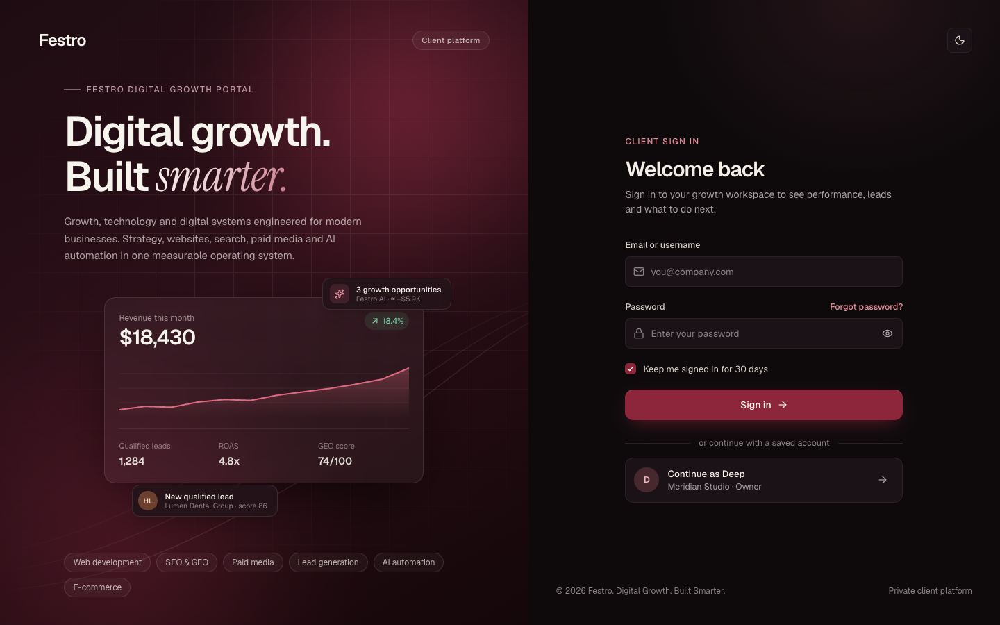 **Sign in** with one-click "Continue as" | 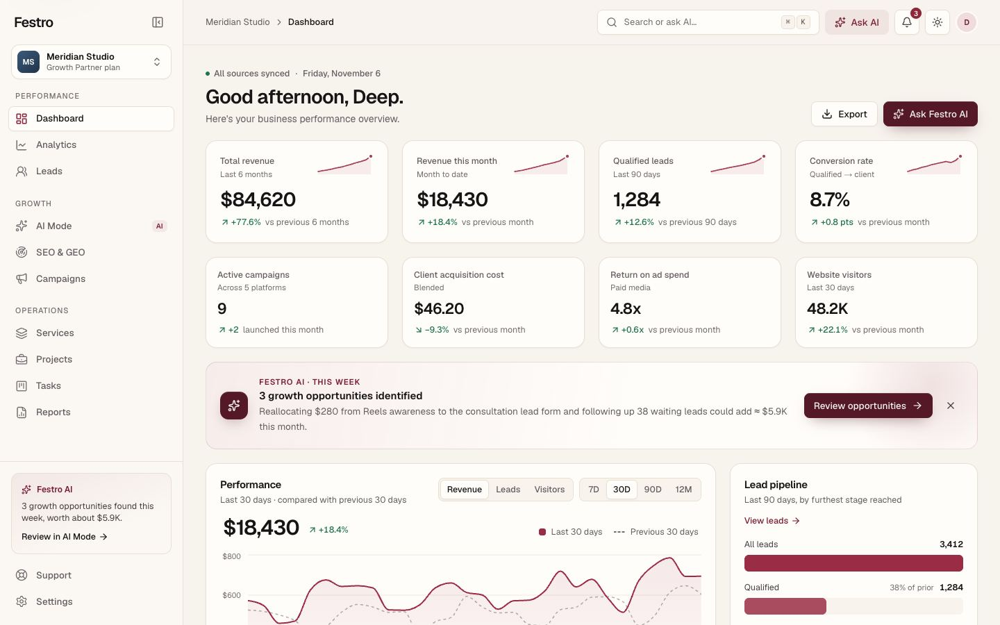 **Dashboard** in the light theme |
| 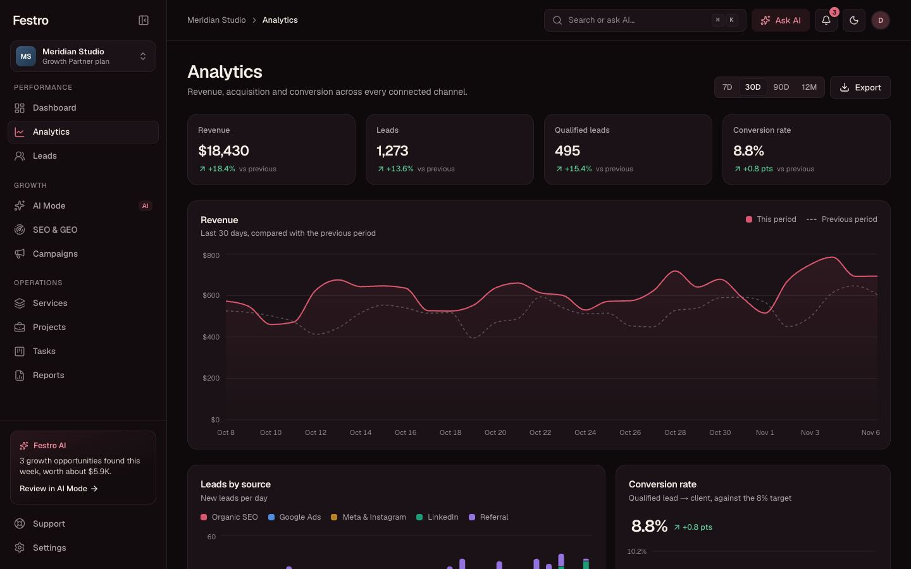 **Analytics** with date ranges and comparisons | 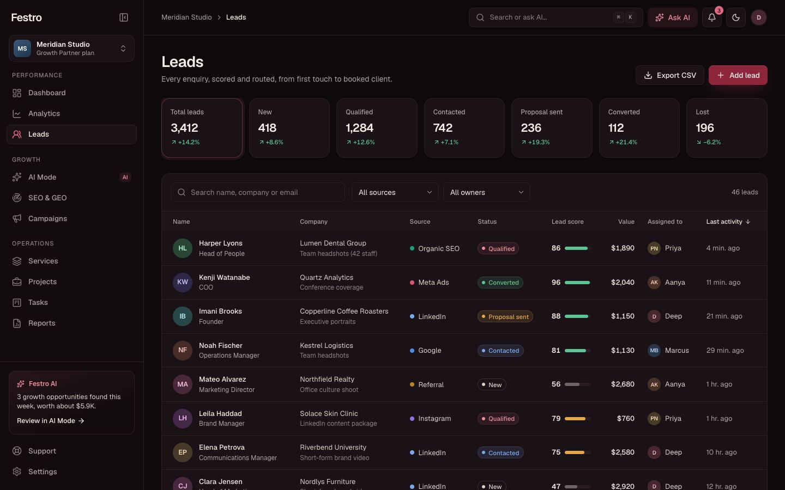 **Leads** pipeline, filters and scoring |
| 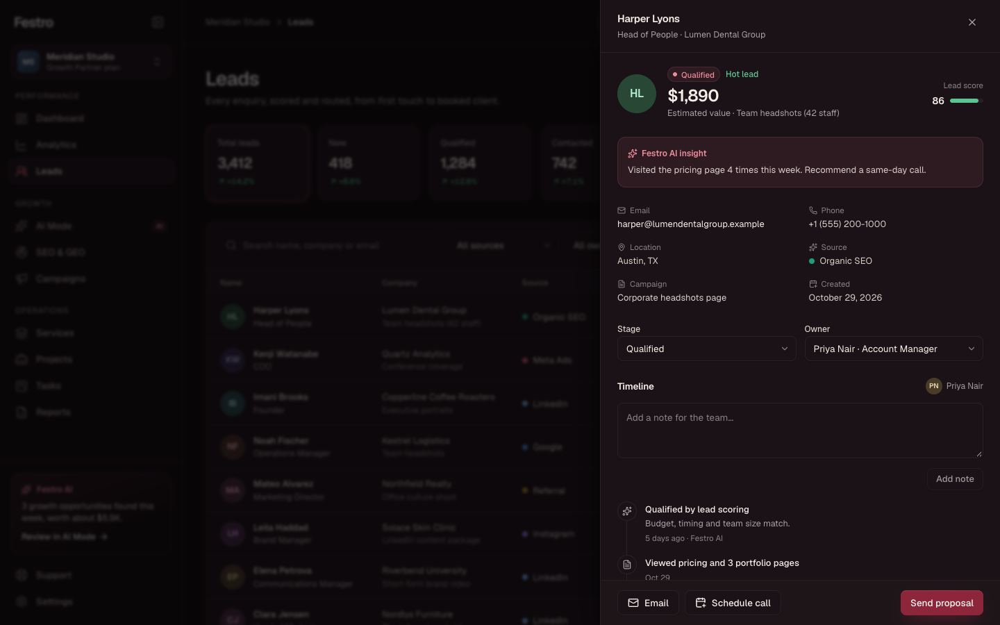 **Lead details** with AI insight and timeline | 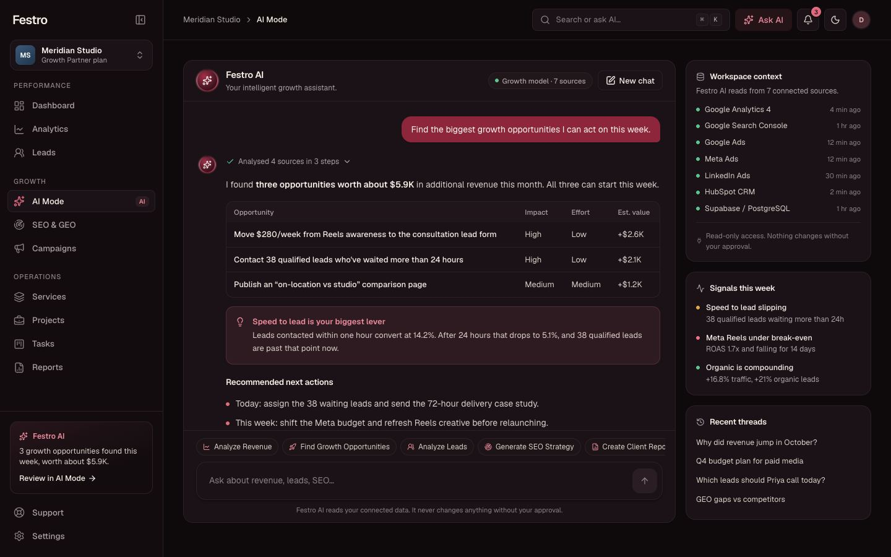 **Festro AI** answering with tables and next steps |
| 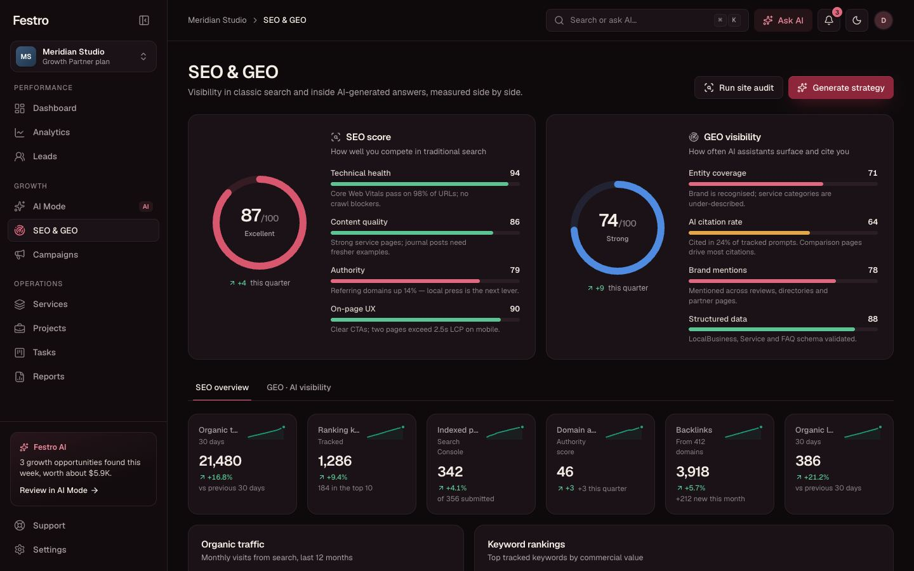 **SEO & GEO** scores, keywords and AI engines | 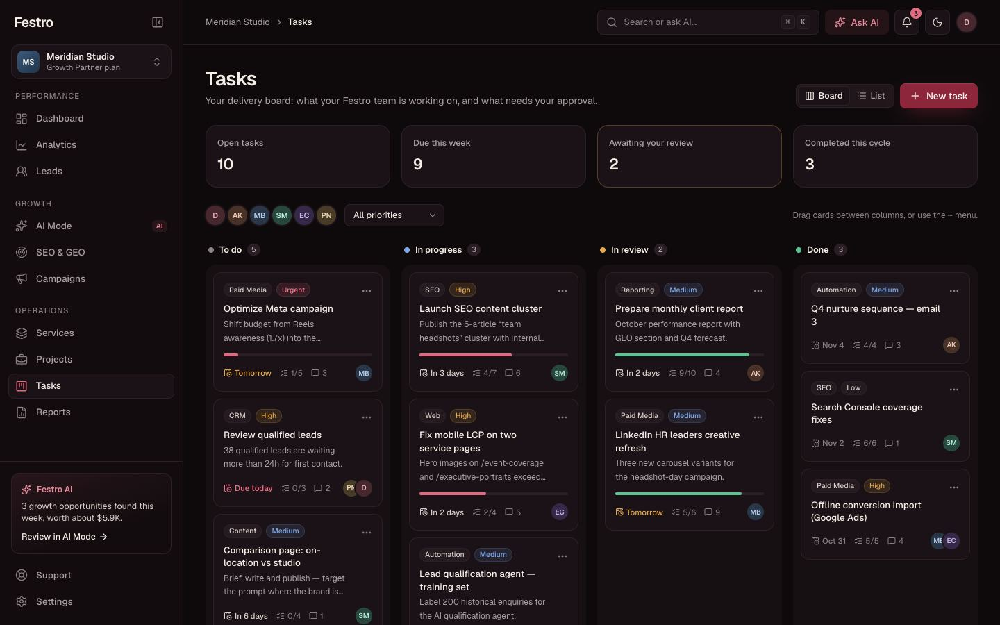 **Tasks** drag-and-drop delivery board |
| 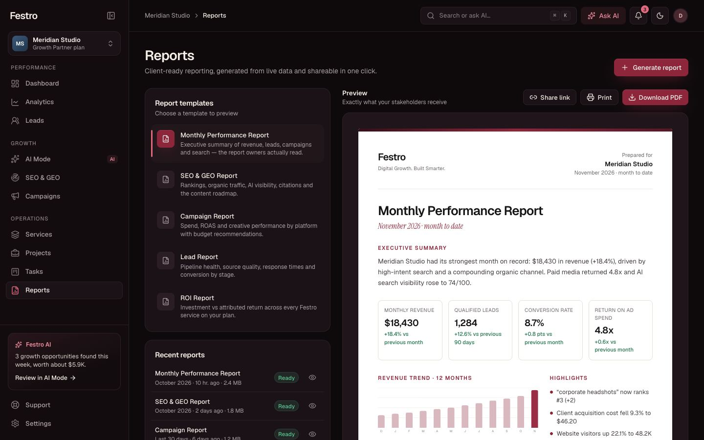 **Reports** with a print-ready preview | 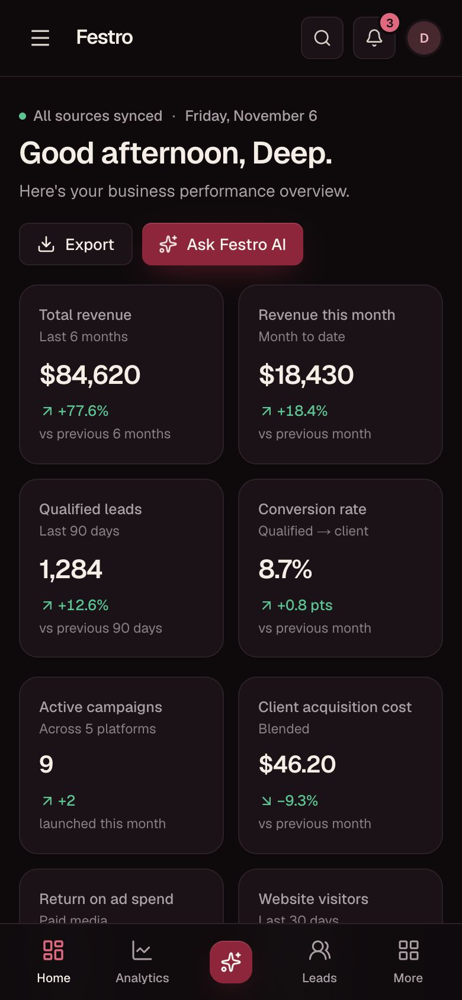 **Mobile** layout with bottom tab bar |

---

## Features

- **Sign-in:** email and password with validation, show/hide password, "keep me signed in", forgot-password flow, and a one-click **Continue as** saved account.
- **Dashboard:** eight KPIs with trends, a revenue/leads/visitors chart (7D, 30D, 90D, 12M), lead pipeline, top campaigns, traffic sources, live activity, priority work and search visibility.
- **Analytics:** revenue against the previous period, leads by source, conversion rate against target, spend vs revenue by platform, ROAS ranking, landing pages, devices and funnel.
- **Leads:** pipeline stage filters, search, source and owner filters, sorting, pagination, CSV export, add-lead form, and a detail drawer with AI insight, stage/owner changes, notes and timeline.
- **Festro AI:** a conversational growth assistant with quick actions, visible reasoning steps, typed answers that include metrics, tables, bar charts and next actions, plus stop, regenerate, copy and feedback.
- **SEO & GEO:** SEO score and GEO (AI search) visibility score with breakdowns, organic traffic, keyword rankings, presence across AI engines, tracked prompts, and prioritised content recommendations.
- **Campaigns:** Google Ads, Meta, LinkedIn, organic and email in one table with budget, spend, leads, conversions, revenue and ROAS; weekly charts; pause/resume; detail drawer with advice.
- **Services:** active, onboarding, recommended and available services, each with a result metric and a details dialog.
- **Projects:** case-study cards with results, filters and a full case-study view.
- **Tasks:** Kanban board with drag and drop (mouse, touch and keyboard), list view, filters, task details with approval, and new-task form.
- **Reports:** five templates, a live print-ready preview, PDF download, share link, generation flow and scheduled delivery.
- **Support:** searchable help center, ticket form and ticket list, account-manager contact and system status.
- **Settings:** profile, workspace, appearance (light/dark/system, reduce motion), notifications, integrations, data states and security.
- **Everywhere:** ⌘K command menu, notifications, light and dark themes, keyboard shortcuts, responsive layout from phone to desktop.

---

## User roles

| Role | Who (sample data) | In the portal |
|---|---|---|
| **Client owner** | Deep, Meridian Studio | Signs in, sees every section, approves work waiting in review, manages workspace settings, integrations and security. |
| **Account manager** | Priya Nair | Owns the client relationship: default owner for new leads, main support contact, replies to tickets. |
| **Growth strategist** | Aanya Kapoor | Prepares reports, proposals and automation work. |
| **Paid media lead** | Marcus Bell | Runs campaigns and owns paid-media tasks. |
| **SEO & content lead** | Sofia Marín | Owns rankings, content and GEO work. |
| **Web engineer** | Ethan Cole | Owns website performance and technical tasks. |

The client owner is the account that signs in. Festro team members appear throughout the portal as lead owners, task assignees and report authors. Each person's role is stored in `src/data/user.ts`; with a single sign-in account in this build, per-role permissions aren't enforced yet and would be added alongside a real identity provider.

---

## Signing in

1. Run the app (see below) and open it in a browser.
2. Click **Continue as Deep** for one-click access, or sign in with:

   | Email | Password |
   |---|---|
   | `deep@festro.com` | `growth2026` |

The account is defined in `src/data/user.ts`. Signing in sets a session cookie that `src/proxy.ts` checks before any portal page renders.

---

## Run it

```bash
npm install
npm run dev        # http://localhost:3000
npm run build      # production build (all routes prerender statically)
npm start          # serve the production build
npm run lint
npm run typecheck
```

Requires Node 20+. Set `NEXT_PUBLIC_SITE_URL` to your production domain so canonical URLs, the sitemap and structured data use it. On Vercel, the project's production URL is used automatically.

---

## Stack

- **Next.js 16** (App Router, Turbopack), **React 19**, **TypeScript** (strict)
- **Tailwind CSS 4** with a token-based design system (`src/styles/globals.css`)
- **Radix UI** primitives for dialogs, drawers, menus, popovers, tabs and tooltips
- **Framer Motion** for interaction animation; CSS for page and card entrances
- **Recharts** charts with a colour-blind-validated palette in both themes
- **dnd-kit** for the Kanban board
- **Lucide** icons

---

## Structure

```
src/
  app/                 Routes, metadata, robots, sitemap, OG image, icons
    page.tsx           Public entry and sign-in (SEO, JSON-LD structured data)
    (portal)/          Signed-in portal: one folder per section, all noindex
  views/               Page-level compositions (one per route)
  layouts/             App shell: sidebar, top bar, mobile nav, command menu, menus
  components/
    ui/                Design-system primitives (button, card, badge, inputs, dialog, tabs…)
    charts/            Chart kit and chart types
    shared/            Page header, KPI card, async state wrapper, theme toggle
    <feature>/         Feature components (leads, ai, tasks, reports, login…)
    providers/         Theme, motion preference and toast providers
  data/                Seeded placeholder data (single source of truth for every number)
  lib/
    api/               Resource layer and transport (swap point for real backends)
    ai/                Festro AI engine (swap point for a model API)
  hooks/               useResource, useCountUp, useStoredState, useHotkey
  styles/              Tokens, themes, type scale, motion, print
  types/               Domain model shared by UI and data layer
  proxy.ts             Route protection
```

---

## Connecting real data

Components never import data directly. They call `api.*` from `src/lib/api/index.ts` through the `useResource` hook, which handles loading, empty, error and success states. To connect a backend, replace a resolver body:

```ts
// src/lib/api/index.ts
leads: {
  list: async () => {
    const res = await fetch(`${process.env.NEXT_PUBLIC_API_URL}/leads`);
    if (!res.ok) throw new ApiError("Couldn't load leads", res.status);
    return (await res.json()) as Lead[];
  },
},
```

The same pattern works for Supabase/PostgreSQL, a CRM (HubSpot), analytics (GA4, Search Console) and ad platforms; the types in `src/types` are the contract.

- **Auth:** swap `signIn` in `src/lib/auth.ts` for your identity provider and set an httpOnly session cookie server-side. The proxy check stays the same.
- **AI:** point `src/lib/ai/engine.ts` at a server route that calls your model and returns `AiBlock` JSON. The UI already renders it progressively.
- **Data states:** Settings → Data states previews every section with full data, an empty workspace, or a source that isn't responding.

---

## Quality

- **Accessibility:** landmarks and a skip link, one `h1` per page, labelled form controls, visible focus rings, full keyboard support (⌘K, `[` for the sidebar, `G` then a letter to navigate, keyboard drag-and-drop with screen-reader announcements). Text colours meet WCAG AA (4.5:1). Reduced motion is respected from the OS and from Settings.
- **Responsive:** sidebar, icon rail, then a mobile drawer and bottom tab bar; tables become cards on small screens; no horizontal overflow at phone, tablet or desktop widths.
- **States:** every data section has loading skeletons, an empty state, an error state with retry, and a populated state.
- **Typography and spacing:** a four-step UI type scale (`text-micro`, `text-caption`, `text-body`, `text-title`) and a consistent 16px / 20px layout rhythm.
- **SEO:** title, description, canonical URL, Open Graph and Twitter metadata, generated OG image, icons, manifest, `robots.txt`, `sitemap.xml`, and Organization, ProfessionalService and WebSite JSON-LD. Portal routes are `noindex`.
- **Performance:** every route prerenders statically, entrances are CSS so content is visible before hydration, and project artwork is generated in CSS (no image downloads).

---

## Placeholder data

All people, companies, figures and case studies are realistic placeholders. Email addresses use the reserved `.example` domain and phone numbers use the 555 range, so nothing can reach a real person. No API keys or secrets are committed; `.env*.local` and `.vercel/` are git-ignored.
